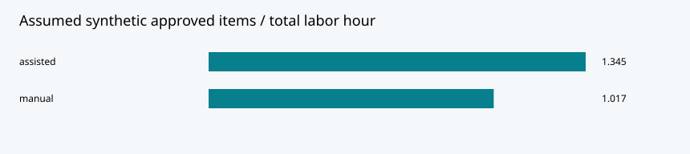

# AI Marketing Transformation & Governance

**Can faster drafting still save work after someone checks the claims?**

This independent research prototype follows a small marketing team at **Northline Demo**, a fictional building-products brand. It connects a product brief to editable copy, brand checks and a human decision. A separate synthetic experiment compares drafting, review and rework effort.

Developed with AI assistance. All briefs, workflow observations and business outcomes are synthetic. There is no company affiliation or production deployment.

## Follow one piece of copy

Choose **B01 — Modular wall panel**, aimed at building contractors. Its supplied demo fact says that the specification lists 45% recycled content. Generate the offline draft, then append **“carbon neutral”**. The checker flags that prohibited phrase and approval is blocked.

Remove the phrase, inspect the supplied fact and confirm factual support. You can now record an approval with a reviewer alias and reason. Edit the copy again: factual confirmation resets, and the changed artifact has a different identifier. The application records decisions locally; it never publishes an advertisement.

This example illustrates the project's central distinction: passing a wording check is not the same as establishing that a claim is true.

## Run it

Use Python 3.10 or newer, from this repository's root:

```bash
python -m venv .venv
# macOS/Linux:
source .venv/bin/activate
# Windows PowerShell: .venv\Scripts\Activate.ps1
python -m pip install -r requirements-dev.txt
python -m portfolio.demo
python -m pytest -q
python -m streamlit run app.py --server.address 127.0.0.1
```

Open the localhost URL shown by Streamlit. The default mode needs no model, API key or external service. The CLI demo uses the Python standard library and rebuilds the JSON results and SVG.

For VS Code with Docker and Dev Containers, choose **Reopen in Container**. The included configuration installs development dependencies and forwards port 8501. Start Streamlit in the container with `python -m streamlit run app.py --server.address 0.0.0.0`. This configuration is for the offline workflow; its image tag and dependency ranges are not an immutable environment lock.

## What is implemented

- **Drafting:** a deterministic template; an optional Ollama HTTP adapter is available but only mock-tested.
- **Checks:** case-insensitive phrase matching for required/prohibited wording and a word limit. The score is a heuristic, not a validated brand-quality measure.
- **Review:** factual confirmation, approve/revise/reject decisions, and a reason. SQLite stores decisions tied to a SHA-256 artifact identifier.
- **Evaluation:** approved items per total labour hour, including review and rework. pandas and Streamlit display the computed metrics.

There is no model training, RAG, semantic fact checker or automated publishing. The review store records identifiers and decisions, not recoverable snapshots of every draft. Reviewer aliases are self-declared; the hash chain is inspectable, not an immutable audit system.

## What the experiment tells us



The 24 invented observations yield 10 approved items in each condition. Assumed total effort is 590 minutes manually and 446 with assistance. The modeled difference is **24.4%**, determined by the inputs—not measured business savings. Assisted review is deliberately slower: 15 rather than 8 minutes per item.

The useful contribution is a way to examine the trade-off. A real pilot would additionally measure rejected work, training and administration costs, independent quality ratings and uncertainty. See the [research report](reports/RESEARCH_REPORT.md) for the proposed study.

## Where to look

- [Guided demo](docs/DEMO.md): the approval scenario and a known checker failure.
- [Architecture](docs/ARCHITECTURE.md): data flow, module responsibilities and trust boundaries.
- [Data definitions](docs/DATA.md): synthetic inputs and metric definitions.
- `portfolio/marketing.py`: draft, checks and calculations.
- `portfolio/governance.py`: review storage and integrity checks.
- `tests/`: domain, governance and Streamlit regression tests.
- [Validation notes](reports/TEST_RESULTS.md): recorded checks and limits.

Run `ruff check .` and `ruff format --check .` before submitting changes. GitHub Actions runs these checks, tests and the demo; a workflow definition alone is not evidence of a successful run.

## Optional local generation

Install and run Ollama locally, set `OLLAMA_MODEL` to an installed model name, then select the optional mode in the app. The adapter calls `http://127.0.0.1:11434/api/generate`. In a container, that address refers to the container—not an Ollama process on your host. Host connectivity needs separate configuration and is outside this offline setup.

Live inference, creative quality, real productivity effects and production readiness remain unvalidated. Only use fictional or approved non-confidential inputs.

## Attribution

See [REUSE.md](docs/REUSE.md) for component provenance. MIT applies to original code and synthetic materials; reused material retains its attribution. The research theme was informed by a user-supplied enterprise thesis topic, not an affiliated company project.
